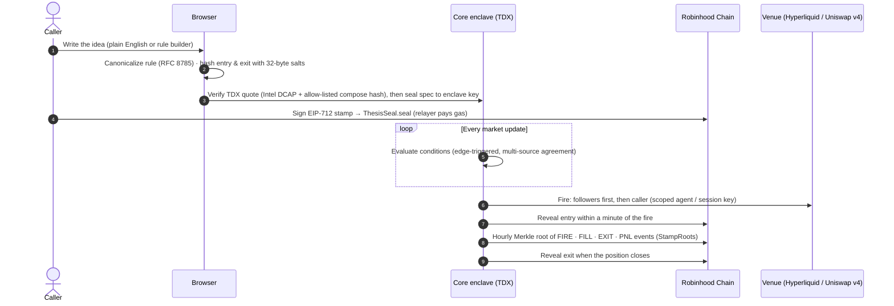
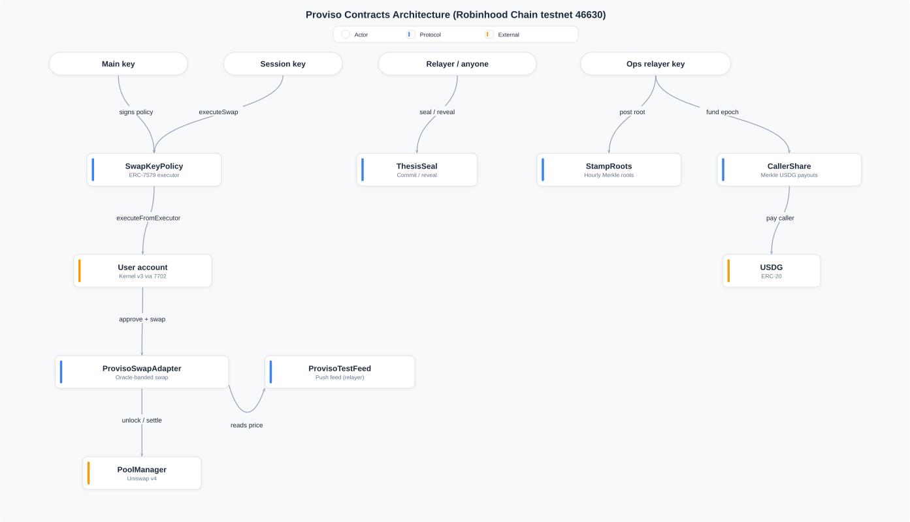
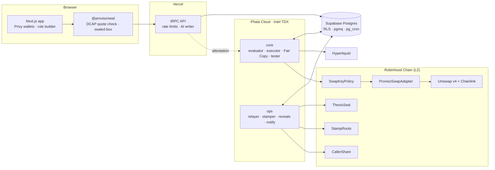

<!-- Public README for github.com/ProvisoFi/ProvisoFinance. Published as /README.md by the mirror script. -->

<p align="center">
  <a href="https://provisofi.com">
    
  </a>
</p>

<p align="center">
  <a href="https://provisofi.com"></a>
  <a href="https://x.com/ProvisoFi"></a>
  <a href="https://github.com/ProvisoFi/ProvisoFinance/actions/workflows/ci.yml"></a>
  
  
  
  <a href="LICENSE"></a>
</p>

<p align="center">
  <b>Proviso is a verifiable track record for trading ideas.</b><br>
  Write a rule in plain English, seal it on-chain before the market moves,<br>
  let an attested enclave execute it, and keep a record nobody can edit after the fact.
</p>

---

## Contents

- [Why Proviso](#why-proviso)
- [How it works](#how-it-works)
- [Architecture](#architecture)
- [Security model](#security-model)
- [Deployed contracts](#deployed-contracts)
- [Deploy and verify](#deploy-and-verify)
- [Repository layout](#repository-layout)
- [Getting started](#getting-started)
- [Testing and verification](#testing-and-verification)
- [Tech stack](#tech-stack)
- [Status and disclaimer](#status-and-disclaimer)
- [License](#license)

---

## Why Proviso

Trading calls are cheap to make and easy to rewrite. Screenshots get cropped, losing calls get deleted, and "I said so" has no timestamp. Proviso makes a call **binding before it plays out**:

| Without Proviso | With Proviso |
| --- | --- |
| A call is a post that can be edited or deleted | A call is a hash committed on Robinhood Chain, with a signed timestamp |
| Entry and exit can be backfilled after the move | Entry and exit are committed separately and revealed on a fixed schedule |
| Copy-traders fill after the caller | Fair Copy fills followers **first**, then the caller |
| "Trust me" execution | Rules run inside a remotely attested TDX enclave with scoped keys |
| Wins are shown, misses vanish | Fired, expired, retired and unrevealed ideas all stay on the record |

---

## How it works



1. **Write.** Describe the idea in plain English and the writer turns it into a strict, typed rule, flagging anything ambiguous. Or use the rule builder.
2. **Review.** A deterministic read-back shows exactly what will trade, and where it ends.
3. **Seal.** The browser hashes the entry and exit separately, encrypts the rule to the attested enclave, and signs a stamp. The commitment is bound to the owner's address.
4. **Evaluate.** The enclave watches Hyperliquid and Robinhood Chain data and fires only on a false → true edge, with price agreement and liquidity floors.
5. **Execute.** Orders go out through trade-only keys: a Hyperliquid agent, or an ERC-7579 session key that can only call the swap adapter within signed caps.
6. **Record.** Reveals and hourly Merkle roots make every event provable, and missing events detectable.

---

## Architecture

<p align="center">
  
</p>



| Component | Role |
| --- | --- |
| **Browser** | Holds the plaintext rule and salts before sealing; verifies the enclave quote; signs stamps, swap policies and approvals. |
| **API (Vercel)** | Auth, per-address rate limits, the rule writer, and queues. It never sees a plaintext spec. |
| **core enclave** | Decrypts sealed specs inside TDX, evaluates conditions, signs orders with scoped keys, and runs the replay tester. |
| **ops enclave** | Relays seals and reveals, posts hourly stamp roots and epochs, and delivers Telegram and Web Push notifications. |
| **Contracts** | Non-upgradeable and ownerless. They hold commitments, roots, payouts and the swap boundary. |

---

## Security model

**Enforced on-chain**
- **ThesisSeal.** Commitments are `keccak256(owner ‖ canonical ‖ salt)` and can't be replayed under another address. Only the relayer chooses reveal kinds within each kind's time window. The owner keeps a late `EXPIRED` fallback.
- **SwapKeyPolicy.** An ERC-7579 executor. A session key may only call `ProvisoSwapAdapter.swap` on allow-listed pools, within per-transaction, per-day and expiry caps. A revoke voids every policy signed before it.
- **ProvisoSwapAdapter.** It requires an oracle-banded `minOut`, a bounded oracle age, and an exact-amount approval. It refuses swaps while a Stock Token's oracle is paused for a corporate action, or while a multiplier change is unpriced.
- **CallerShare.** Pull-based Merkle claims, one claim per leaf, and claimed ≤ funded.

**Enforced in the enclave**
- **Signer policy.** Every order must map to a live idea, stay inside the idea's and the user's limits, keep exits reduce-only, and price within 2% of mark.
- **Seal key.** Keys are derived from the dstack KMS and bound to the attested application. The browser seals only to a quote that passes Intel DCAP verification, has a known dstack OS, has an allow-listed compose hash and is not a debug TD.

**Honest boundaries**
- **The relayer is a hot key.** It is the reveal and root poster, so it can delay but not forge commitments. It runs inside the ops enclave.
- **Trust in third parties.** Proviso trusts Intel TDX, Phala's KMS, Chainlink equity feeds (24/5 hours) and the Robinhood Chain sequencer. Robinhood Chain has no sequencer-uptime feed.
- **The web deploy controls the allow-list.** The allow-list is only as trustworthy as the published source and the build.

Roles and their holders, the incident runbook, accepted risks and known issues are in [SECURITY.md](SECURITY.md).

---

## Deployed contracts

**Robinhood Chain mainnet** (chain ID `4663`), deployed at block `94518595` from a fresh, single-use deployer that holds no role afterwards.

| Contract | Address |
| --- | --- |
| ThesisSeal | [`0xfe47c96d8496519beb7ce4642c3bc0adf83efee3`](https://robinhoodchain.blockscout.com/address/0xfe47c96d8496519beb7ce4642c3bc0adf83efee3) |
| StampRoots | [`0x5c15f152747f52b63613e710e3acec2b8413f7b3`](https://robinhoodchain.blockscout.com/address/0x5c15f152747f52b63613e710e3acec2b8413f7b3) |
| CallerShare | [`0x967d0bbe0c6c0106815a01971cc42ece0fd4b1a4`](https://robinhoodchain.blockscout.com/address/0x967d0bbe0c6c0106815a01971cc42ece0fd4b1a4) |
| ProvisoSwapAdapter | [`0xcb0b0d2f0b4440b96161b39c7808dccaa3733c0d`](https://robinhoodchain.blockscout.com/address/0xcb0b0d2f0b4440b96161b39c7808dccaa3733c0d) |
| SwapKeyPolicy | [`0x7242dc76248421006cec4651b73489f243914a9d`](https://robinhoodchain.blockscout.com/address/0x7242dc76248421006cec4651b73489f243914a9d) |

The live bytecode, immutables, roles and EIP-712 domains can be checked against this repository:

```bash
CHAIN_NETWORK=mainnet bun packages/chain/scripts/post-deploy-check.ts
```

The full deploy record, with transactions, blocks and constructor arguments, is in [`packages/chain/deployments/mainnet.json`](packages/chain/deployments/mainnet.json).

---

## Deploy and verify

Everything below can be re-checked from a clone of this repository.

**Contracts.** [`packages/chain/scripts/deploy-mainnet.ts`](packages/chain/scripts/deploy-mainnet.ts) deploys ThesisSeal, StampRoots, CallerShare, ProvisoSwapAdapter and SwapKeyPolicy from a fresh, single-use deployer key. It refuses to run if the deployer is the relayer, if the relayer differs from `packages/chain/src/chains.ts`, or if the RPC is not chain 4663. The relayer receives the three roles, and the deployer keeps none. Each step (address, transaction, block, constructor arguments) is written to [`packages/chain/deployments/mainnet.json`](packages/chain/deployments/mainnet.json) as it lands, so a re-run resumes.

```bash
cd contracts && forge build && cd ..
bun packages/chain/scripts/gen-abi.ts
CHAIN_NETWORK=mainnet DEPLOYER_PRIVATE_KEY=… RELAYER_ADDRESS=… bun packages/chain/scripts/deploy-mainnet.ts
```

Anyone can verify the live contracts. The check is read-only and exits 1 on any mismatch. It covers bytecode against the local build (immutables masked), roles, USDG, PoolManager, `maxOracleAge` (90000 s), the adapter link and the EIP-712 domains:

```bash
cd contracts && forge build && cd ..
CHAIN_NETWORK=mainnet bun packages/chain/scripts/post-deploy-check.ts
```

**Enclave images.** [`.github/workflows/images.yml`](.github/workflows/images.yml) runs only in this public repository, on pushes to `main`. It builds `services/Dockerfile` for `core` and `ops`, pushes `ghcr.io/provisofi/proviso-<svc>` to GHCR and attaches Sigstore build provenance. Deploys always pin the image digest in `services/<svc>/docker-compose.yml`, so the attested compose names exact code. To check that a pinned digest was built here from a given commit:

```bash
gh attestation verify oci://ghcr.io/provisofi/proviso-core@sha256:<digest> --repo ProvisoFi/ProvisoFinance
```

**Enclave deploy (Phala Cloud).** Pin the new digest in the compose file, build the env file from the variable names that compose file lists (values never go in the repository), then deploy with the Phala CLI (`bunx phala@1.1.22 deploy --cvm-id <cvm> -c services/<svc>/docker-compose.yml -e <env file> --wait`). A core redeploy changes its compose hash. The new hash goes into [`packages/seal/src/allowed-compose.ts`](packages/seal/src/allowed-compose.ts) in the same change, and the old one is dropped after the switch.

**Verify the core enclave.** The browser checks this on every seal, and anyone can repeat it by hand:
- The core CVM's public `/prpc/Info` returns `tcb_info.app_compose`. Its sha256 is the `compose_hash`, and it must equal an entry in `ALLOWED_COMPOSE_HASHES`.
- The `docker_compose_file` inside `app_compose` must be byte-identical to `services/core/docker-compose.yml`, including the pinned image digest.
- `mrtd`, `rtmr1` and `rtmr2` must equal a pinned dstack OS in `ALLOWED_OS`, and RTMR3 must replay from the event log.
- In the browser, [`packages/seal`](packages/seal/src/attestation.ts) verifies the TDX quote with Intel DCAP. It refuses debug TDs, unknown OS images and compose hashes outside the allow-list, and it requires the sealing key to be bound into `REPORTDATA`. The quote comes from the API's `idea.attestation` query, proxied unchanged from the core enclave.

**Web, API and database.** The Next.js app and tRPC API deploy to Vercel from `apps/web`. The required variable names are in `apps/web/.env.example`. The database is Supabase Postgres: apply `supabase/migrations` in order, with Web3 sign-in enabled.

---

## Repository layout

```text
.
├── apps/
│   └── web/              Next.js 16 app: workspace, composer, records, proofs
├── packages/
│   ├── dsl/              Rule language: zod schema, validator, RFC 8785, commitments, read-back
│   ├── seal/             TDX quote verification (Intel DCAP) and sealed-box encryption
│   ├── api/              tRPC routers, rate limits, AI rule writer
│   ├── chain/            viem clients, ABIs, network config, swap policies, deploy scripts
│   ├── hl/               Hyperliquid info / exchange / WebSocket client and signing
│   └── db/               Drizzle schema and an in-process Postgres test harness
├── services/
│   ├── core/             Enclave: evaluator, executor, Fair Copy, signer policy, tester
│   └── ops/              Enclave: relayer, stamper, reveals, roots, epochs, notifications
├── contracts/            Foundry: ThesisSeal, StampRoots, CallerShare, SwapAdapter, SwapKeyPolicy
└── supabase/             SQL migrations: schema, RLS, queues, triggers
```

---

## Getting started

**Prerequisites:** [Bun](https://bun.sh) `1.3.13`, [Foundry](https://book.getfoundry.sh) `1.5.x`, and Node `>= 22.18` for the Next.js toolchain.

```bash
git clone https://github.com/ProvisoFi/ProvisoFinance.git
cd ProvisoFinance
bun install --frozen-lockfile
```

Build and test the contracts. Core's tests read the compiled artifacts, so build first:

```bash
bash contracts/install-deps.sh
cd contracts && forge build && forge test
```

Run every TypeScript suite:

```bash
bun run test
```

Run the web app locally. Copy `apps/web/.env.example` to `apps/web/.env.local` and fill in your own keys:

```bash
bun run dev
```

The network is selected by `CHAIN_NETWORK` / `NEXT_PUBLIC_CHAIN_NETWORK` (`testnet` or `mainnet`) and `HL_NETWORK`.

---

## Testing and verification

| Layer | What runs | Count |
| --- | --- | --- |
| Contracts | Unit, negative and fuzz tests (Foundry) | **160** tests |
| Contracts | Stateful invariants: claims ≤ funding, day caps, `minOut` honoured, revoke is final | **7** invariants × 16k calls |
| Enclave · core | Evaluator, executor, Fair Copy, signer-policy fuzz, tester | **227** tests |
| Enclave · ops | Relayer, stamps, reveals, epochs, Telegram, swaps | **101** tests |
| Packages | dsl · seal · hl · db · chain · api | **139** tests |
| CI | Tests, Slither, Semgrep and gitleaks on every push | [](https://github.com/ProvisoFi/ProvisoFinance/actions/workflows/ci.yml) |

Every contract invariant, where it is enforced and the exact test that checks it are listed in [docs/INVARIANTS.md](docs/INVARIANTS.md).

**Supply chain**
- Exact pins for security-relevant libraries.
- A 7-day release-age gate on installs.
- Install scripts blocked by default.
- Digest-pinned base images.
- Enclave images built in public CI with Sigstore provenance.

---

## Tech stack

| Area | Stack |
| --- | --- |
| Frontend | Next.js 16 · React 19 · Privy (external + embedded wallets) |
| API | tRPC 11 · zod 4 · Vercel AI SDK |
| Data | Supabase Postgres · Drizzle · pgmq · pg_cron |
| Enclaves | Bun · Phala Cloud dstack · Intel TDX |
| Chain | Robinhood Chain (Arbitrum Orbit) · viem · EIP-7702 · ERC-4337 v0.7 · ZeroDev Kernel v3.3 |
| Markets | Hyperliquid perps · Uniswap v4 · Chainlink Stock Token feeds |
| Contracts | Solidity 0.8.26 · Foundry · OpenZeppelin |

---

## Status and disclaimer

- **Live.** Proviso is live on Robinhood Chain mainnet and Hyperliquid mainnet.
- **Audit.** The code has been through an AI-assisted security review (latest grade **8.6 / 10**, 2026-10-22; full report in [docs/AUDIT.md](docs/AUDIT.md)). It has **not** had an independent human audit yet, so use small amounts.
- **Stock Tokens.** Robinhood Stock Tokens are not available to U.S. persons and are subject to Robinhood's terms.
- **Not investment advice.** Proviso doesn't hold your funds; trades run through keys you approve and can revoke. Trading carries risk of loss.

To report a vulnerability, email security@provisofi.com or DM [@ProvisoFi](https://x.com/ProvisoFi) on X rather than opening a public issue. See [SECURITY.md](SECURITY.md).

---

## License

[MIT](LICENSE)

<p align="center">
  <sub>Write with intent. Act within limits. Keep the record.</sub><br>
  <a href="https://provisofi.com">provisofi.com</a> · <a href="https://x.com/ProvisoFi">@ProvisoFi</a>
</p>
